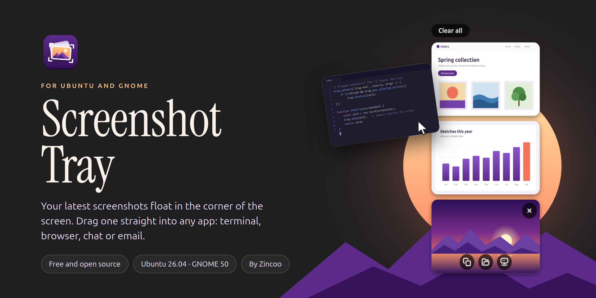
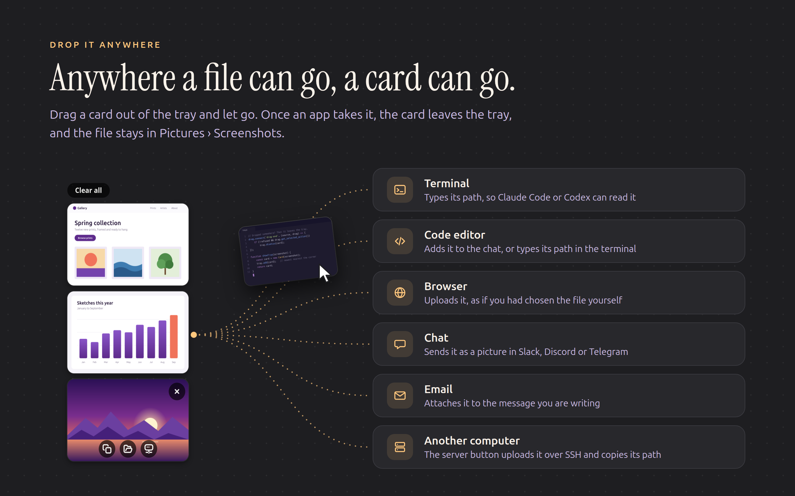
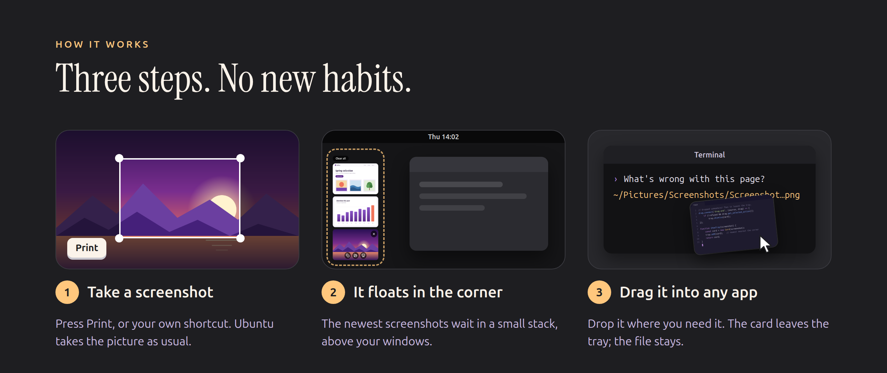
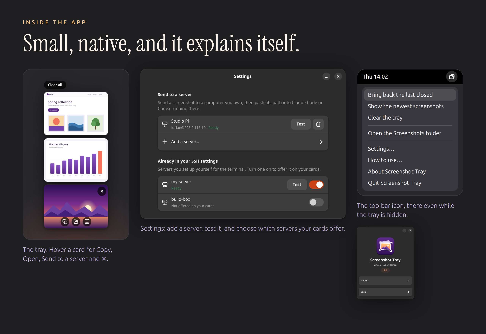
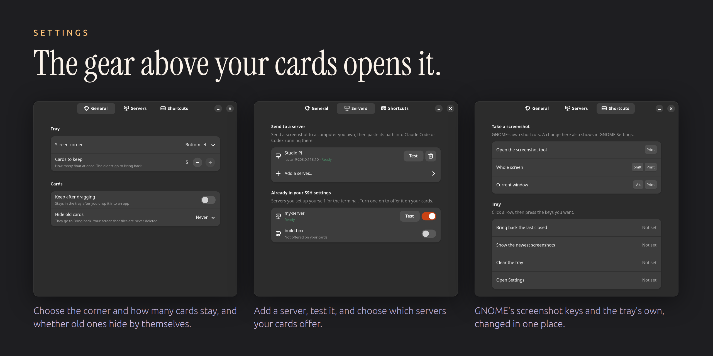
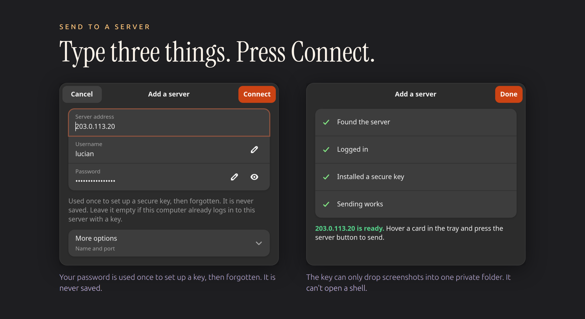
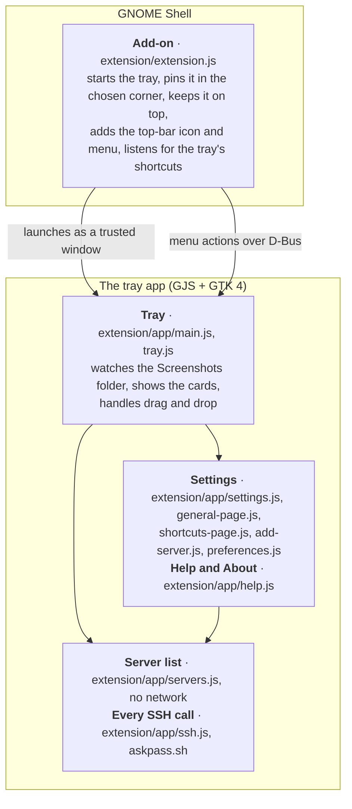

<p align="center">
  
</p>

<p align="center">
  <a href="LICENSE"></a>
  
  
  
</p>

<p align="center">
  <b>Screenshot Tray</b> keeps your latest screenshots floating in the corner of the screen,<br>
  so you can drag them straight into Claude Code, Codex, a browser, a chat or an email.<br>
  It's the floating stack known from CleanShot X on the Mac, for Ubuntu.
</p>

<p align="center">
  <a href="#install">Install</a> ·
  <a href="#how-it-works">How it works</a> ·
  <a href="#features">Features</a> ·
  <a href="#questions">Questions</a>
</p>

## Drop it anywhere



A card behaves like the screenshot file itself, so it goes anywhere a file can go. Once an
app accepts it, the card leaves the tray, and the file stays in *Pictures → Screenshots*.

## How it works



Screenshot Tray doesn't replace Ubuntu's screenshot tool. It watches the folder where
Ubuntu saves screenshots and shows each new one as a card.

## Install

You need **Ubuntu 26.04** (GNOME 50, Wayland). It has only been tested there; other
systems with GNOME 50 will probably work.

```bash
git clone https://github.com/romanlucian/screenshot-tray.git
cd screenshot-tray
./install.sh
```

Then **log out and back in once**, because GNOME loads new add-ons only at login. After
that the tray starts by itself, and its icon appears in the top bar.

**To update later:** run `git pull` and `./install.sh`, then log out and back in once.

> **Tip:** to paste a screenshot into Claude Code in a terminal with <kbd>Ctrl</kbd>+<kbd>V</kbd>
> instead of dragging it, install the clipboard helper: `sudo apt install wl-clipboard`.

## Features

| | |
|---|---|
| **Floating stack** | Each new screenshot appears in the corner of the screen, above your windows. Up to 5 stay. |
| **Drag into any app** | A terminal gets the file's path; a browser, chat or email gets the file. |
| **Tidies itself** | A card leaves once an app accepts it, unless you choose to keep it. **Clear all** empties the tray, and it hides when empty. |
| **Settings** | The gear above your cards: the corner, how many cards stay, hiding old ones, your servers and your keyboard shortcuts. |
| **Bring back** | Closed a card by mistake? Bring it back from the tray or the top-bar menu. |
| **Send to a server** | For Claude Code or Codex on another computer: set up a server in *Settings*, then one click uploads the screenshot over SSH and copies its path there. |
| **Top-bar icon** | Reaches the tray even while it's hidden: bring back, clear, open the folder, settings, help, quit. |
| **Built-in help** | *How to use…* explains everything in plain words. |
| **Stays out of the way** | It never takes the keyboard, stays out of Alt+Tab and the dock, and is sharp on HiDPI screens. |
| **Safe** | It never deletes a screenshot, needs no `sudo`, and goes online only when you use *Send to a server*, or set up, test or remove a server in *Settings*. |

## Inside the app



## Settings



Press the **gear** above your cards, choose *Settings…* in the top-bar menu, or right-click
the app's icon and choose **Settings**.

- **General:** bottom-left or bottom-right corner, 1 to 5 cards, keeping a card after you drag
  it, and hiding old cards after 5, 15 or 60 minutes. Hidden cards go to *Bring back*, and
  the files stay.
- **Servers:** see below.
- **Shortcuts:** GNOME's own shortcuts for taking a screenshot, and shortcuts for the tray.
  The tray's start empty, so they can't clash with anything. A combination GNOME already uses
  just does its usual job, so choose another one. A letter alone isn't allowed, because
  it would break typing.

The screen corner and the tray's shortcuts come from the GNOME add-on, so they start working
after you log out and back in once. *Settings* tells you when that's still needed.

## Sending to a server



The server button on each card is for Claude Code or Codex running on another computer
over SSH. It uploads the screenshot to that computer and copies its path there: click in
that terminal and press <kbd>Ctrl</kbd>+<kbd>Shift</kbd>+<kbd>V</kbd>.

**To set one up:** open *Settings* → *Servers* → *Add a server…*. Enter the address, your
username and your password, then press **Connect**. It works with a **Linux or Mac
server**, such as a cloud machine, a home server or a Raspberry Pi.

- **Your password** is used once to set up a key, then forgotten. It is never saved. If
  this computer already logs in to the server with a key, leave the password empty.
- **The key is limited.** On the server it can only drop screenshots into one private
  folder, `~/.cache/screenshot-tray/inbox`, or remove itself. It can't open a shell.
- **Servers already in your `~/.ssh/config`** appear in *Settings* with a switch. They start
  off, and the app never changes your SSH files.
- **Logins that ask for a code (2FA) and Windows servers don't work.** If a step fails, the
  app says why in a plain sentence.
- **If Claude Code runs inside a container** on the server, share
  `~/.cache/screenshot-tray/inbox` with the container, or it won't see the file.

**Worth knowing:**

- **The first connection is taken on trust**, as with SSH itself. The app shows the server's
  ID and asks before continuing, but most people can't check an ID by hand. If someone were
  intercepting that very first connection and you accepted, your password would go to them.
- **Screenshots stay on the server** unencrypted until you delete them, private to your
  account. Anyone with admin rights there can read them, so send sensitive screens only to
  servers you trust. They travel encrypted.
- **Servers switched on from your SSH settings use your full login**, not the limited key.
- **The key on this computer has no passphrase**, because it must work without asking. If
  someone copied it, they could fill the server's disk with files in that folder, but they
  would already need access to your account here.

## What it adds to your computer

Everything goes in your own home folder. It needs no `sudo` and changes no system files.

| What | Where |
|---|---|
| The GNOME add-on, as a link to this folder | `~/.local/share/gnome-shell/extensions/screenshot-tray@zincoo.com` |
| Its entry in GNOME's list of add-ons | the setting `org.gnome.shell enabled-extensions` |
| The app's entry in the app list | `~/.local/share/applications/com.zincoo.ScreenshotTray.desktop` |
| The app's icon, as a link to `data/` | `~/.local/share/icons/hicolor/scalable/apps/com.zincoo.ScreenshotTray.svg` |
| The tray's note of which cards are showing, and which left | `~/.cache/screenshot-tray/cards.json` |
| The list of servers, the app's own key, and the server IDs you trusted | `~/.config/screenshot-tray/` (private to your account) |
| The choices in *Settings*, once you change one | GNOME's settings, under `/org/gnome/shell/extensions/screenshot-tray/` |
| On a server you send to: the screenshots you sent | `~/.cache/screenshot-tray/inbox/` (private to your account) |
| On a server you added: one line for the limited key | `~/.ssh/authorized_keys` |

## Uninstall

```bash
./uninstall.sh
```

This removes everything in the table above from this computer, and your screenshots are
never touched. GNOME's own screenshot shortcuts stay as you set them: *Settings* can put them
back to GNOME's defaults before you uninstall. It can't reach your servers, so remove them in *Settings* first: that also
takes the key's line off each one. A line left behind is useless without this computer's
key. Screenshots you sent stay in that server's inbox folder.

## Questions

<details>
<summary><b>Does it replace Ubuntu's screenshot tool?</b></summary>
<br>
No. Take screenshots exactly as before, with <kbd>Print</kbd> or your own shortcut.
Screenshot Tray only shows what Ubuntu saves.
</details>

<details>
<summary><b>Where do my screenshots go?</b></summary>
<br>
Where they always did: <i>Pictures → Screenshots</i>. Closing a card, clearing the tray
or dropping a card somewhere never deletes the file.
</details>

<details>
<summary><b>Why do I have to log out once after installing?</b></summary>
<br>
GNOME loads new add-ons only when you log in. After that one time, the tray starts by
itself with every login.
</details>

<details>
<summary><b>Does it send my screenshots anywhere?</b></summary>
<br>
Only when you use <i>Send to a server</i>, or set up, test or remove a server in
<i>Settings</i>, and only to servers you added or turned on, over SSH. Otherwise it never goes online.
</details>

<details>
<summary><b>How do I close it, and start it again?</b></summary>
<br>
Top-bar icon → <i>Quit Screenshot Tray</i>. It stays off, even after the next login,
until you click <b>Screenshot Tray</b> in the app list.
</details>

<details>
<summary><b>Why does it need a GNOME add-on?</b></summary>
<br>
On Wayland, GNOME doesn't let apps place their own windows or keep them on top; only the
desktop itself can. The small add-on does exactly that one job, and everything else is an
ordinary GTK app.
</details>

## For developers

<details>
<summary><b>How the pieces fit together</b></summary>
<br>



- The add-on starts the tray the same way Ubuntu's own desktop icons start their window
  (`ding@rastersoft.com`), so GNOME trusts it and lets the add-on place it. If the tray
  crashes 5 times in a row, the add-on leaves it off until the next login.
- **Without the add-on** (for example before the first log-out), the tray runs as an
  ordinary window: `gjs -m extension/app/main.js`. Drag it by its title bar, then
  right-click the title bar for *Always on Top*.
- **The settings** are described in `extension/schemas/`. After changing that file, run
  `glib-compile-schemas extension/schemas` and commit the result; `tests/run.sh` checks it.
- **The README pictures** are designed from real parts of the app, which
  `tools/render-app-parts.sh` draws off-screen using the made-up demo screenshots in
  `tools/demo/` and a made-up server list. No real screenshot or setting of yours is ever
  published.
- **Tests:** `tests/run.sh` needs nothing special, `tests/ui.sh` presses the real windows on
  an invisible display, `tests/addon.sh` runs the real add-on and tray in a separate, invisible
  GNOME Shell and presses real keys and clicks there, and `tests/integration.sh` sets up and
  sends to real SSH servers in throwaway Docker containers, on 127.0.0.1 only. All of them use
  a made-up home folder.
- Built for GNOME 50: a newer GNOME may need the add-on updated.

</details>

## Credits

Made by [Zincoo](https://zincoo.com) · Lucian Roman

## License

Copyright © 2026 Lucian Roman, [Zincoo](https://zincoo.com).
Released under the [GPL-3.0-or-later](LICENSE).
